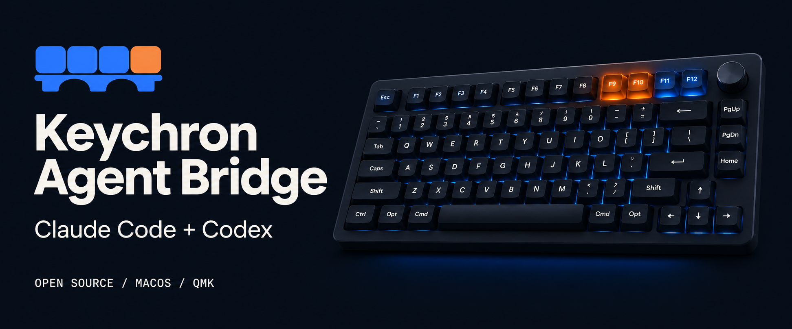

<p align="center">
  
</p>

<p align="center">
  <a href="https://github.com/Jacknelson6/keychron-agent-bridge/actions/workflows/ci.yml"></a>
  <a href="LICENSE"></a>
  
  
  
</p>

<h3 align="center">Agent activity, on your keyboard.</h3>

<p align="center">
  A local, open-source bridge for Claude Code, Codex, and Keychron.<br>
  Quiet status lights. Useful prompt shortcuts. A knob that picks your agent.
</p>

<p align="center">
  <a href="docs/SETUP.md">Get started</a> ·
  <a href="docs/EXTENDING.md">Build your own visuals</a> ·
  <a href="firmware/README.md">Bluetooth firmware</a> ·
  <a href="CONTRIBUTING.md">Contribute</a>
</p>

## A small display you already own

Claude working in the background? One orange function key per active session,
against a steady blue backlight. No need to bring its window to the front.
The animation runs on the keyboard, roughly once every four seconds.

| Claude sessions | F9 | F10 | F11 | F12 |
| :-- | :--: | :--: | :--: | :--: |
| 0 | Blue | Blue | Blue | Blue |
| 1 | **Orange** | Blue | Blue | Blue |
| 2 | **Orange** | **Orange** | Blue | Blue |
| 3 | **Orange** | **Orange** | **Orange** | Blue |
| 4+ | **Orange** | **Orange** | **Orange** | **Orange** |

**Orange keys pulse. The rest stay blue.** Normal brightness, Caps Lock,
pairing indicators, battery warnings, and idle power saving remain in place.

The default visual counts **Claude Code**, including local Claude Desktop Code
sessions. Codex has lifecycle hooks, prompt shortcuts, and agent selection;
it does not add orange keys in this default layout. The extension guide shows
where to build a Codex visual or replace the layout entirely.

## More than lighting

| Control | Action |
| :-- | :-- |
| Fn + turn knob | Select Claude Code or Codex |
| Fn + press knob | Open an editable prompt |
| Fn + F9 | Review changes |
| Fn + F10 | Explain clipboard |
| Fn + F11 | Run project checks |
| Fn + F12 | Summarize a session |

The normal knob stays volume/mute. Tasks open in the original interactive CLI,
with its existing login and permission prompts. No additional model API key.
[See all controls and session rules →](docs/USAGE.md)

## Start with the verified setup

This is an early, hardware-tested project with deliberately narrow support.

| Component | This release |
| :-- | :-- |
| Host app | macOS, Python 3.12 |
| Keyboard | **Keychron V1 Max ANSI knob**, VID `3434`, PID `0913` |
| USB lighting | Factory v1.1.1, build `2025-04-30-10:37:08` |
| Bluetooth lighting | Optional custom main firmware, radio test, and macOS permission |
| Other Keychron models / Windows / Linux app | Contributions welcome; not verified or supported yet |

**First USB connection backs up and installs the listed Fn mappings and temporary
lighting.** Read the [setup guide](docs/SETUP.md) before installing. Firmware
flashing is a separate, explicit advanced step. No factory firmware or recovery
dumps are distributed here.

```sh
git clone https://github.com/Jacknelson6/keychron-agent-bridge.git
cd keychron-agent-bridge
python3.12 scripts/bootstrap.py
sh scripts/build.sh
```

Then follow [installation and hook setup](docs/SETUP.md). USB is the simplest
starting point. Bluetooth uses a model-specific extension that preserves the
settings sector and leaves the separate radio firmware unchanged.

## Make it yours

The project separates lifecycle events, session state, and keyboard output.
Build an attention light, a Codex palette, a different indicator layout, or a
new hardware backend.

```sh
# Preview a custom palette without a keyboard or installation.
python3.12 examples/custom_visual.py --agent codex --status working
```

[Extension guide](docs/EXTENDING.md) · [Architecture](docs/ARCHITECTURE.md) ·
[Firmware protocol](firmware/keychron_agent/agent_protocol.h)

## Local by design

Hooks forward lifecycle metadata to a private local socket. They do not forward
prompts, transcripts, credentials, tool arguments, or tool output. Bluetooth
reports carry only a count and preserve the Mac's Caps Lock bit. There is no
cloud service or host animation polling loop.

Login startup, automatic crash recovery, and an event-driven session recovery
helper keep it running. **Restart Keyboard Lights** on the Desktop provides
manual recovery. [Permissions, privacy, and recovery →](docs/SETUP.md)

## Build together

Ideas, verified keyboard ports, visuals, and bug reports are welcome. Start with
[contributing](CONTRIBUTING.md), [open an issue](https://github.com/Jacknelson6/keychron-agent-bridge/issues),
or [discuss a visual](https://github.com/Jacknelson6/keychron-agent-bridge/discussions).

Licensed **GPL-2.0-or-later**, matching the firmware extension's QMK heritage.
See [LICENSE](LICENSE) and [NOTICE](NOTICE). An independent community project,
not affiliated with Keychron, Anthropic, or OpenAI.
