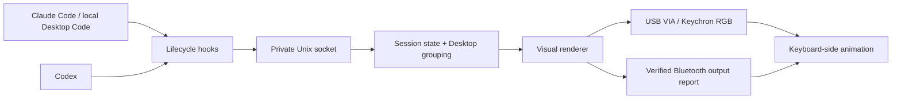

# Architecture

The default renderer displays Claude's active leaf-session count, capped at four
physical indicators. The menu keeps the full count. Codex state is available for
custom renderers and prompt controls, but does not contribute to that default.

| Module | Responsibility |
| :-- | :-- |
| `hook.py` | Allowlisted lifecycle metadata; silent publisher |
| `broker.py` | Singleton lock and private local IPC |
| `state.py`, `desktop_sessions.py` | State, deduplication, parent/child grouping |
| `app.py`, `native.py` | Menu-bar UI, registered shortcuts, device/wake events |
| `keyboard.py`, `session_lights.py` | USB transactions and restoration |
| `bluetooth.py` | Shared output reports with preserved Caps Lock |
| `session_recovery.py`, `service.py` | Login/crash supervision and recovery |
| `firmware/keychron_agent` | Model-specific decoder and RGB overlay |

USB RGB writes are temporary. Mapping installation is separately backed up and
verified. Runtime colors never call save-to-EEPROM commands. Firmware is built
and flashed only by separate explicit scripts.

`launchd` supervises the app. A one-shot job watches its startup marker and seeds
busy sessions from Claude's local registry. It matches PID, start time, and
`claude` process name, not the binary signature. Hooks then maintain live state.
The seed skips newer observed events and is best-effort, not an atomic transaction
with concurrent provider activity.

Device and wake notifications drive reconnects. The keyboard handles animation;
there is no host animation polling loop. Standard idle power saving is preserved.
